# pptx-AI-Slide-Forge

An AI Agent Skill that forges **premium dark-tech PPTX presentations**: procedurally
generated backgrounds (liquid glass ribbons, ribbed metallic surfaces), glassmorphism
cards, strict content discipline, and an honest render-based QA loop.

Compatible with AI agents supporting the [Agent Skills](https://agentskills.io) format
(Claude Code, Codex, and others).

## Why

Most AI-generated decks look like generic corporate templates: flat gradients, clip-art
icons, text walls. This skill encodes a different pipeline — one that was battle-tested
on a real 8-slide technical deck end to end:

- **Procedural backgrounds** — no stock images. Multi-layer "liquid electric blue"
  ribbon fields or ribbed metallic surfaces are generated with numpy + PIL, with dark
  text zones preserved by luminance sanity checks.
- **Glass surfaces in PPTX** — translucent smoked-glass cards with luminous borders
  (real alpha via DrawingML XML), solid electric accent cards with glow backdrops.
- **Composable shape layers** — HUD rings, dot fields, bezier swooshes and wireframe
  terrain drawn over the background; per-slide decision matrix and restraint rules.
- **Five built-in styles** — Midnight Electric Blue, NovaPay Liquid Electric Blue
  (dark), Clean Blue Tech (light corporate), Dark Emerald Strategy (executive
  roadmap), Obsidian Ember (industrial editorial); full JSON specs + an AI-authoring
  recipe.
- **Content discipline** — every slide title is an action title stating the takeaway;
  the ghost deck test must pass before anything is built; ~40 words of body text max.
- **Honest QA** — slides are rendered to PNG and visually inspected; text is extracted
  and checked; geometry is linted for out-of-bounds shapes and text overlaps. If a
  check fails, the build is fixed and re-run. No "it should work" claims.

## Built-in styles

| Style | Mood | Background engine |
|---|---|---|
| **Midnight Electric Blue** | Premium tech / dark editorial | Ribbed metallic surfaces, arcs, dot grids |
| **NovaPay Liquid Electric Blue** | Premium fintech / liquid glass | Layered glossy liquid ribbons with icy speculars |
| **Clean Blue Tech** | Light corporate / editorial | Flat white backgrounds, vector diagrams, royal-blue accents |
| **Dark Emerald Strategy** | Executive roadmap / emerald glow | Liquid ribbons with an emerald palette, mint rims |
| **Obsidian Ember** | Industrial tech / SaaS / ember editorial | Near-black to burgundy base, molten orange ribbons and hot-orange glows |

Sample backgrounds generated by this skill (see `skills/pptx-ai-slide-forge/assets/`):

- `sample_bg_liquid_hero.png` — hero cover: sweeping liquid ribbons, dark headline zone
- `sample_bg_liquid_content.png` — content slide: corner-anchored ribbons, quiet middle band
- `sample_bg_light_corporate.png` — light corporate: white field, pale blue washes, faint dots
- `sample_bg_dark_emerald.png` — executive roadmap: emerald glow, mint accents
- `sample_bg_obsidian_ember.png` — industrial editorial: ember streaks, orange glow

All five style specifications (color tokens, typography, card systems, do/don't rules)
live in [`skills/pptx-ai-slide-forge/references/styles.md`](skills/pptx-ai-slide-forge/references/styles.md),
together with a recipe for writing your own style.

## Design examples

Actual renders from the worked example deck (NovaPay Liquid Electric Blue style,
Keynote render of the real build output):

**Hero cover** — liquid ribbon field, glass chip, outlined CTA; the dark left zone
is reserved for the headline:

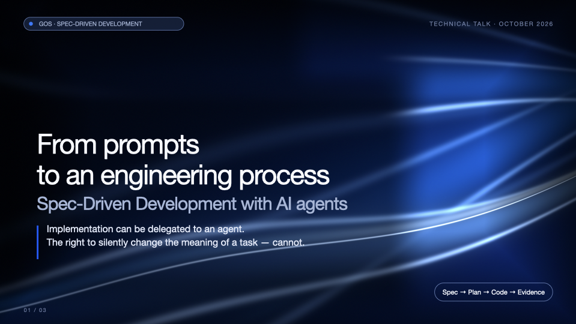

**Content slide** — glass case card, translucent pill stack, electric accent card
with glow:

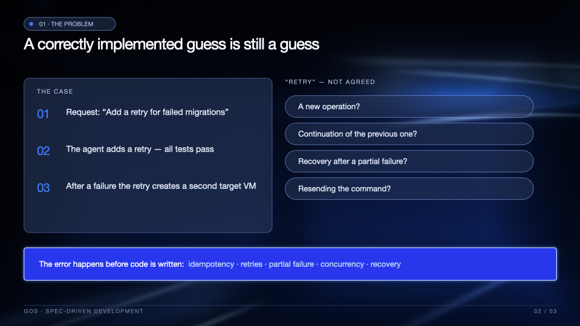

**Three-level cards** — glassmorphism with luminous tags and quiet dividers:

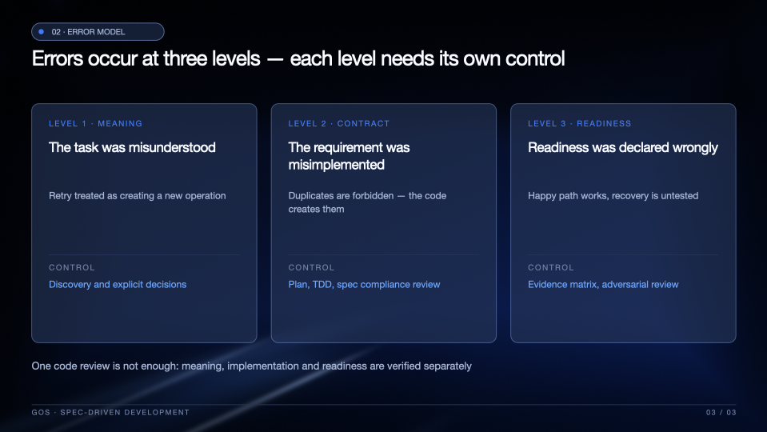

### Composable shape layers (v1.1)

HUD arc fields and rings, dot grids with radial falloff, bezier swooshes and
projected wireframe terrain — drawn over the liquid base
(`examples/shape-gallery`):


### Clean Blue Tech — light corporate theme

White backgrounds, royal-blue accents, vector diagrams — cover with a floating
platform, royal-blue contents grid, radial network visualization
(`examples/clean-blue-tech`):

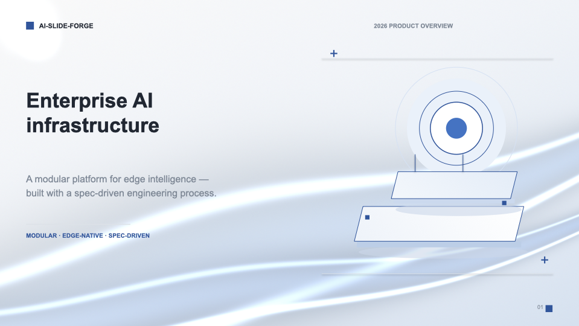

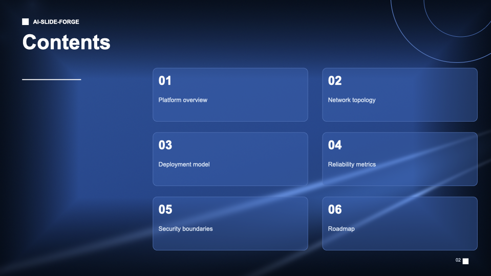

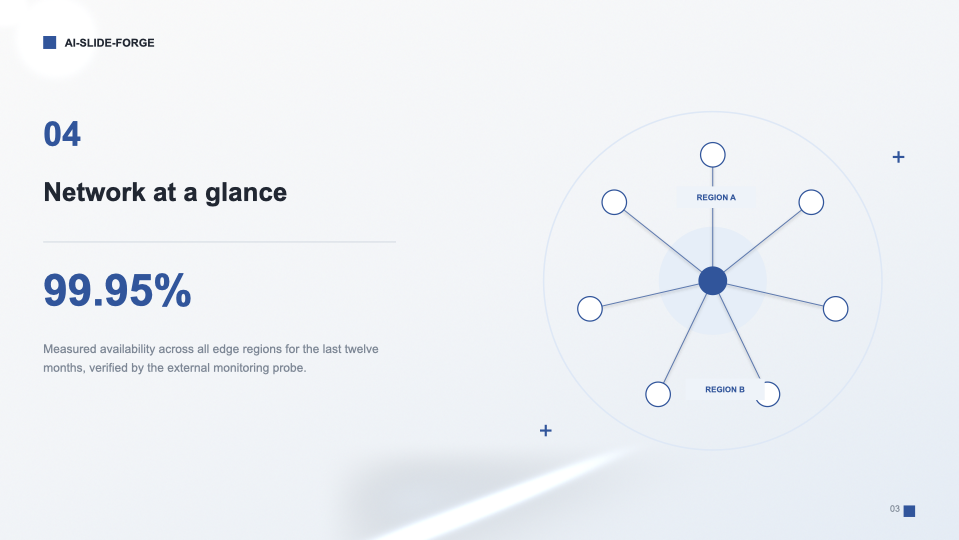

### Dark Emerald Strategy — executive roadmap

The liquid engine with an emerald palette and mint accents
(`examples/dark-emerald-strategy`):

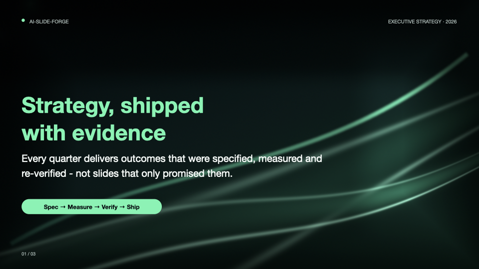

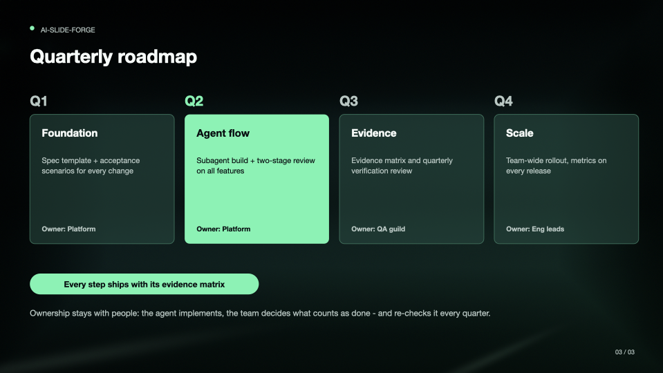

### Obsidian Ember — industrial editorial

Near-black to burgundy with molten orange highlights — uppercase brutalist cover,
before/after workflow comparison, KPI cards (`examples/obsidian-ember`):

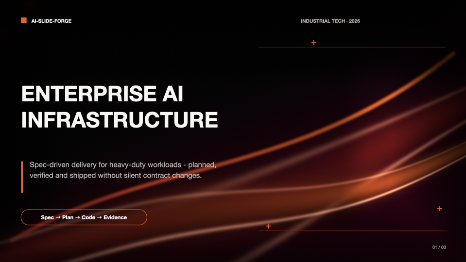

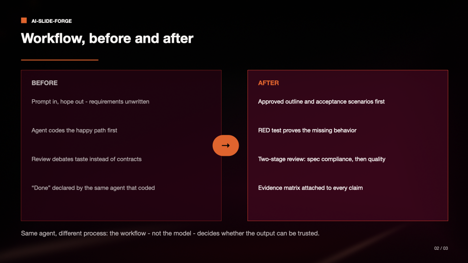

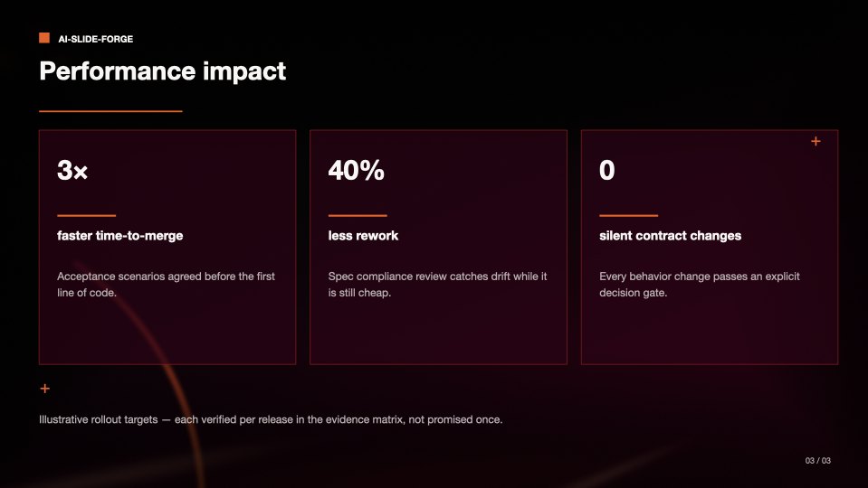

More renders: `docs/images/`.

## Workflow — how to work with the skill

The agent-facing workflow (with hard gates) lives in
[`skills/pptx-ai-slide-forge/SKILL.md`](skills/pptx-ai-slide-forge/SKILL.md). The
human-visible summary:

| Step | What happens | Gate |
|---|---|---|
| 1. Intake & outline | Source material compressed into 7–10 slides with **action titles**; ghost-deck test (titles alone tell the argument); remaining decisions asked in one batch, each with a recommendation | user approves the outline |
| 2. Style | A built-in style is chosen, or a new style JSON is authored with AI (recipe below) | theme tokens extracted |
| 3. Backgrounds | Per-slide configs → `make_textures.py` → luminance report per text zone; **the PNGs are opened and looked at** | dark text zones + eyes agree |
| 4. Build | `build_deck.py` adapted (theme tokens at the top, one section per slide) | geometry lint clean |
| 5. Render QA | Every slide rendered to PNG and visually inspected | fix list empty (≤ 3 iterations) |
| 6. Text QA | `qa_check.py`: slide count, key strings, forbidden strings | all green |
| 7. Deliver | Deck + renders + a QA report stating exactly what was verified — and what was not | honest report |

## Author your own style (JSON, with AI)

A style is a **JSON specification** — the repo ships five complete style specs in
[`references/styles.md`](skills/pptx-ai-slide-forge/references/styles.md). To create a
new one with AI:

1. Collect inputs: 1–3 reference screenshots, brand HEX colors (or permission to
   derive them), mood words, audience, deck language (the font must render Cyrillic
   if the deck is Russian).
2. Hand them to the AI with the ready-made prompt template from
   [`references/styles.md` → *"Authoring a new style JSON with AI"*](skills/pptx-ai-slide-forge/references/styles.md#authoring-a-new-style-json-with-ai).
   The JSON must define: canvas, palette with `dominant_color_ratio` (one accent
   family), a layered `background_system` (base gradient + atmospheric glows +
   volumetric forms — never a flat gradient), `glass_card_system` with explicit
   opacities, single-font `typography`, `critical_visual_rules`, `negative_prompt`.
3. Validate before mass production: fill every field (an empty field is style
   drift), build **one dense test slide**, render it, compare with the references,
   refine the JSON — not the slide.

Unit conversion for implementation: **1 px at 1920 = 0.5 pt** on the 13.333 × 7.5 in
slide; radius 18 px = 0.125 in; letter-spacing `spc` = 1/100 pt.

## Quick start

Install the skill into your agent's skills directory:

```bash
git clone https://github.com/<you>/pptx-AI-Slide-Forge.git
mkdir -p .claude/skills
cp -R pptx-AI-Slide-Forge/skills/pptx-ai-slide-forge .claude/skills/
```

| Agent | Skills directory |
|---|---|
| Claude Code | `.claude/skills/` (project) or `~/.claude/skills/` (user) |
| Codex | `.agents/skills/` |
| Others | per the agent's documentation |

Then just ask your agent:

> Use pptx-ai-slide-forge to build a 7–8 slide deck from my-notes.md
> in the NovaPay Liquid Electric Blue style.

The agent will propose a slide outline for approval first, then generate backgrounds,
build the deck, render every slide to PNG, inspect them, and fix what fails.

## The scripts

All scripts are battle-tested on a real deck; adapt, don't rewrite:

| Script | Purpose |
|---|---|
| `scripts/make_textures.py` | Parametric background engine (liquid ribbons + ribbed metal), config-driven, prints luminance sanity per text zone |
| `scripts/build_deck.py` | Reference python-pptx builder: theme tokens, glass/accent cards, pills, tables, flows, footers, geometry lint |
| `scripts/qa_check.py` | Text QA via markitdown + geometry lint (bounds, text overlaps) for any .pptx |
| `scripts/render_qa.sh` | Renders deck slides to PNG via Keynote (with the PowerPoint pitfall documented) |

## QA pipeline

1. **Geometry lint** — every shape within slide bounds; no two text blocks overlapping.
2. **Text QA** — markitdown extraction: slide count, key strings present, forbidden
   strings absent (e.g. no "Thank you" slide).
3. **Render QA** — every slide exported to PNG (Keynote, AppleScript) and *actually
   looked at*: clipped text, wraps, contrast, style fidelity.
4. **Luminance sanity** — background text zones stay dark; texture lives in corners
   and edges.

Details and known platform pitfalls: [`skills/pptx-ai-slide-forge/references/qa-and-toolchain.md`](skills/pptx-ai-slide-forge/references/qa-and-toolchain.md).

## Repository structure

```
pptx-AI-Slide-Forge/
├── README.md                        # this file
├── LICENSE                          # MIT
├── docs/design.md                   # design decisions behind the skill
└── skills/pptx-ai-slide-forge/
    ├── SKILL.md                     # agent-facing workflow (entry point)
    ├── scripts/                     # make_textures.py, build_deck.py, qa_check.py, render_qa.sh
    ├── references/                  # styles.md, background-engine.md, slide-patterns.md, qa-and-toolchain.md
    ├── assets/                      # sample backgrounds (five styles)
    ├── examples/english-demo/       # 3-slide EN demo (NovaPay style)
    ├── examples/clean-blue-tech/    # 3-slide EN demo (light corporate)
    ├── examples/dark-emerald-strategy/  # 3-slide EN demo (emerald roadmap)
    ├── examples/obsidian-ember/     # 3-slide EN demo (ember industrial editorial)
    ├── examples/shape-gallery/      # v1.1 shape layers showcase configs
    └── examples/sdd-deck/           # worked example: 8-slide SDD deck (configs + content outline)
```

## Dependencies

Python **3.10+** (3.11 verified):

```bash
pip install python-pptx pillow numpy "markitdown[pptx]"
```

| Package | Used for | Verified version |
|---|---|---|
| `python-pptx` ≥ 1.0 | deck build — glass alpha via DrawingML XML, letter-spacing (`spc`), tables | 1.0.2 |
| `Pillow` ≥ 10 | background rendering — LANCZOS downscale, GaussianBlur depth layers | 11.2.1 |
| `numpy` ≥ 1.24 | procedural background math (ribbon fields, glows, noise) | any recent |
| `markitdown[pptx]` ≥ 0.1.9 *(optional)* | text-extraction QA | 0.1.9 |

Render QA (visual check of every slide):

- **macOS + Keynote** — the proven path (AppleScript export, script included).
- Microsoft PowerPoint is **not** usable for scripted export: its AppleScript
  `save as PNG` silently produces nothing (verified; documented in
  `references/qa-and-toolchain.md`). Fine for *manual* viewing, of course.
- LibreOffice / poppler are **not** required.
- `aggdraw` is **not** needed — the current background engine is pure numpy + PIL.

## Example

[`examples/sdd-deck/`](skills/pptx-ai-slide-forge/examples/sdd-deck) contains the
worked example this skill was extracted from: an 8-slide technical talk
("Spec-Driven Development with AI agents") in the NovaPay Liquid Electric Blue style —
per-slide background configs, the content outline, and the build script as the
reference implementation.

## License

MIT — see [LICENSE](LICENSE).

## Credits

Content discipline adapted from academic presentation best practices (action titles,
ghost deck test, exhibit-per-slide). Style specifications were authored for this
project by visual analysis; all colors and metrics are approximations, not extracted
design tokens.
